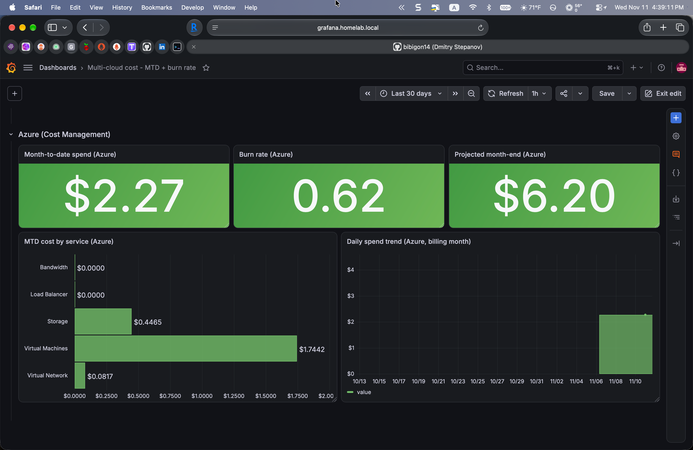
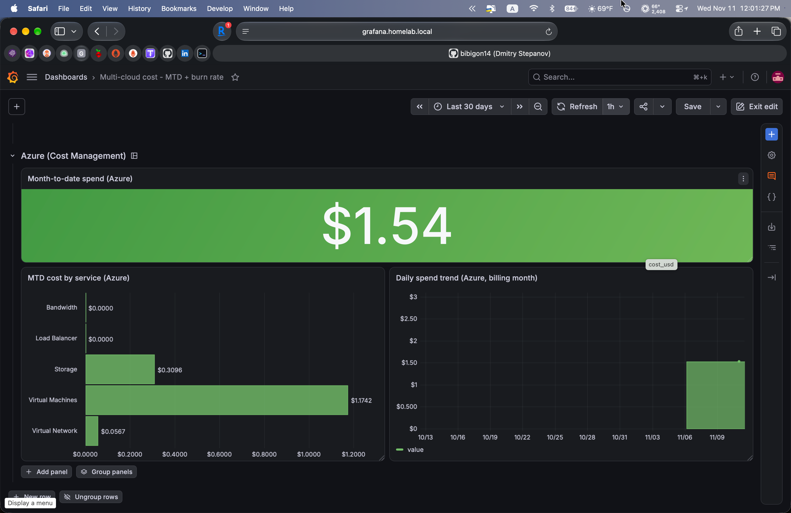
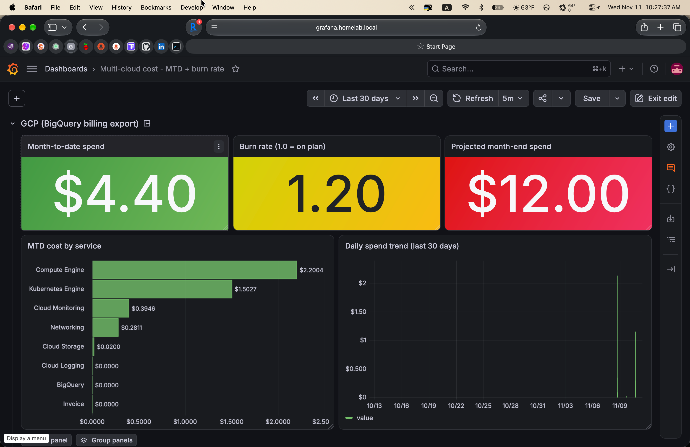
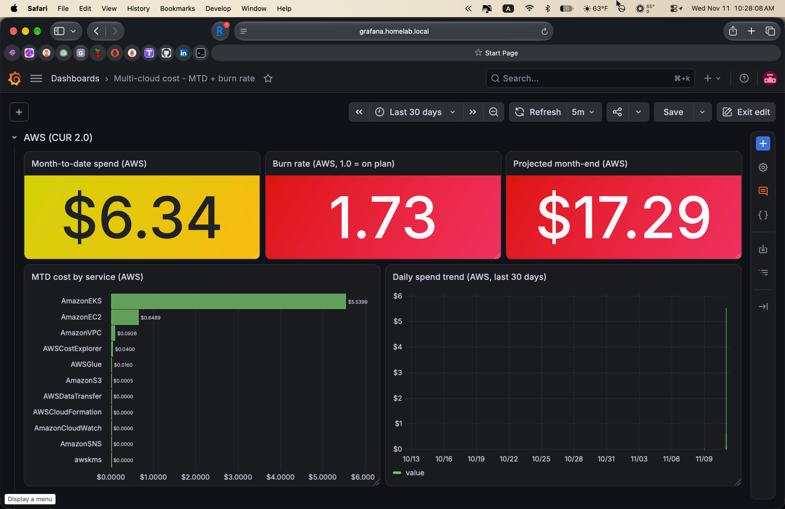
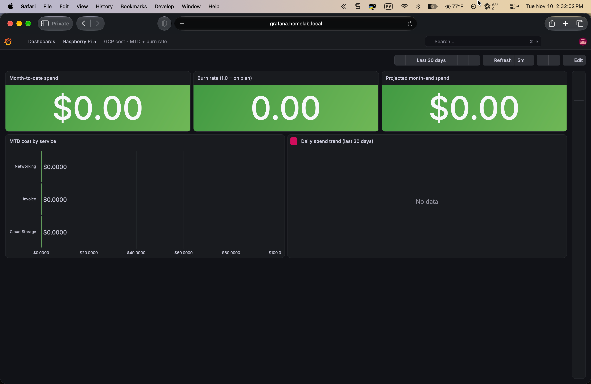

# multi-cloud-finops

Multi-cloud FinOps cost observability platform. Burn-rate alerts applied to
cloud spend instead of just error budgets - because a forgotten GPU node
at 03:00 UTC is just as much a reliability failure as a crashed pod.

Why this exists: a Senior SRE in 2026 is increasingly asked to own cost as
a reliability signal, not a finance concern. This project ports the SRE
playbook (SLO targets, error budgets, burn-rate alerts, runbook-driven
response) onto cost metrics, and demonstrates it across GCP, AWS, OCI and
Azure in one Grafana.

## What's inside

```
multi-cloud-finops/
├── terraform/            BQ dataset + IAM + Grafana service account
├── queries/              Reference SQL for each export format
├── grafana/              Datasource + dashboards + burn-rate alerts
├── docs/
│   ├── architecture.md   Data flow, three export types, Terraform scope
│   ├── narrative.md      Why this exists, cross-cloud angle, resume read
│   ├── decisions/        Architecture Decision Records (MADR)
│   ├── incidents/        Post-mortems for incidents this project caught
│   └── runbooks/         On-call runbooks for the alerts
└── README.md             (you are here)
```

## Status

- **v0.5 (2026-11-12)** - Kubernetes namespace attribution (3-cloud).
  Adds a new "Kubernetes namespace attribution" row underneath the GCP /
  AWS / Azure MTD rows: three horizontal bar charts, one per cloud, each
  showing cost attributed to the namespace where it was actually
  consumed. Uses the native, cloud-first mechanism per vendor rather
  than a uniform third-party overlay:
  - **GCP**: GKE Cost Allocation feature enabled on the finops-demo
    Autopilot cluster (`gcloud container clusters update
    --enable-cost-allocation`). The `goog-k8s-namespace`,
    `goog-k8s-cluster-name` and `goog-k8s-workload-name` labels start
    flowing into the Detailed BigQuery billing export's `system_labels`
    array on the first hourly flush post-enablement. First-time
    activation can take up to 24h to backfill per GCP docs, so the
    panel may show "No data" on ship-day and populate overnight.
  - **AWS**: Container Insights add-on (`amazon-cloudwatch-observability`)
    installed on the EKS cluster plus Split Cost Allocation Data opt-in
    for Amazon EKS in Billing & Cost Management > Settings. SCAD then
    writes `split_line_item_*` rows into CUR 2.0 with
    `resource_tags['aws_eks_namespace']` populated by Container
    Insights pod metrics. Nine new `split_line_item_*` columns added
    to the CUR query_statement (actual_usage, parent_resource_id,
    reserved_usage, split_cost, split_usage, split_usage_ratio,
    unused_cost, public_on_demand_split_cost,
    public_on_demand_unused_cost).
  - **Azure**: The public Cost Management Query API does not expose
    a Namespace/k8s dimension at subscription scope; the AKS Cost
    Analysis blade in Azure Portal does but reads from a non-public
    backend. The v0.5 Azure panel falls back to `ResourceGroupName`
    grouping - a useful proxy because the AKS managed RG
    (`MC_finops-demo-rg_finops-demo_eastus`) rolls up cluster VMs,
    load balancer and nodes separately from the top-level workload
    RG. Honest limitation worth calling out: full namespace
    attribution on Azure waits on either Microsoft exposing the
    dimension publicly or the project switching to a Cost Management
    export -> Databricks/Synapse federation.

  ![Kubernetes namespace attribution row - all three clouds in one frame. GCP panel shows the inline noValue notice while GKE Cost Allocation backfills (labels appear in Detailed BQ system_labels once the first-time activation window closes); AWS SCAD shows pod-attributable cost split across five namespaces (kube-system $0.0576 control plane, amazon-cloudwatch $0.0533 Container Insights itself, team-data $0.0238, team-platform $0.0083, default $0); Azure RG fallback shows the AKS managed RG at $5.26, the user-facing workload RG at $1.43, the empty FinOps RG at $0](docs/screenshots/09-v0.5-namespace-row-full.png)

  

- **v0.4.1 (2026-11-12)** - Cloudflare slice (Workers Paid + AE).
  Adds a Cloudflare row with three stats: flat $5/month Workers Paid
  plan cost, 30d request volume pulled live from the
  sre_portfolio_visits Analytics Engine dataset via the AE SQL API,
  and a computed cost-per-1k-requests ratio. Data plane: a new
  `/api/cf-usage` endpoint in sre-worker signs outbound AE SQL
  requests with an Account Analytics Read API token held as a Worker
  secret, returns a flat JSON, caches for 1h in KV. The panel itself
  reuses the same `web-urls` Infinity datasource created for the OCI
  row. The point of the panel is the narrative around fixed-plan
  services: they look "expensive per request" at low volume but are
  justified by features (CPU time, AE access), not by request
  headroom - a standard FinOps conversation about plan right-sizing.

  

  

- **v0.4 (2026-11-12)** - OCI as the fourth cloud (Always Free).
  Adds an OCI row with two panels: an Always Free $0.00 MTD stat and
  a bar chart of 30d usage quantity by service (Compute ~10K OCPU-hours,
  Block Storage, Virtual Cloud Network, Telemetry). OCI's Usage API
  uses the draft-cavage HTTP Signatures authentication scheme
  (`keyId=<tenancy>/<user>/<fingerprint>`, `algorithm=rsa-sha256`),
  which Grafana Infinity's OAuth2 / Basic / Bearer modes do not
  natively support, so rather than ship a Python side-car running on
  the Pi or commit a static JSON blob to the repo, the integration
  lives in sre-worker: a new `/api/oci-usage` endpoint implements OCI
  signing from scratch in ~130 lines of WebCrypto (RSA-SHA256), caches
  the response in KV for 1h, and returns a flat usage document that
  the Grafana panel reads over a public HTTPS URL. Secrets handling
  survives the two gotchas that bit during the integration pass:
  trailing "OCI API KEY" footer comments inside the PEM file would
  poison the base64 payload (strict BEGIN/END slice fix), and
  `grep "^<field>=" ~/.oci/config` on a multi-profile config returns
  one line per profile which `wrangler secret put` stores joined by
  newlines (first-line trim on every secret).

  A local fallback script `scripts/fetch_oci_usage.py` ships alongside
  the proxy: it uses the OCI Python SDK locally to dump the same
  payload shape to disk. Useful if the proxy is unavailable or for a
  non-Grafana consumer; the dashboard itself always reads from the
  Worker endpoint.

- **v0.3.1 (2026-11-11)** - Azure row symmetry.
  Added burn rate stat + projected month-end stat so the Azure row
  matches the GCP and AWS shape: three stats across the top (MTD /
  burn / projected), bar chart and daily trend below. Same green /
  yellow / red threshold ladder as the other two clouds (burn 1.0 /
  1.5, projected at budget / 1.5x budget, $10/month portfolio budget).
  Both new panels reuse the Infinity MTD-total query and compute the
  derived number via Grafana `calculateField` transforms with
  hardcoded `day_of_month / days_in_month` multipliers - the UQL
  parser's date-math functions (`format_datetime`, `toint`, `now()`)
  returned "No data" in this environment, so the pragmatic fix is a
  daily patch script that regenerates the multipliers from today's
  date and POSTs the dashboard back through the Grafana API. A
  systemd timer on the Pi runs it at 00:05 UTC. Same-day shipped on
  top of v0.3 to lock in the three-cloud money-shot before AKS / EKS
  / GKE Autopilot workloads are torn down.

  

- **v0.3 (2026-11-11)** - Azure joins as the third cloud.
  Cost Management Export (ActualCost, MonthToDate, Daily) writes to a
  dedicated storage account via `azurerm_subscription_cost_management_export`;
  an Entra App Registration + Service Principal with `Cost Management Reader`
  (subscription scope) and `Storage Blob Data Reader` (container scope)
  gives Grafana a least-privilege reader. The dashboard picks up a third
  row - MTD stat, MTD by service bar chart, daily spend trend - with
  all three panels reading live from the ARM Cost Management API via the
  Grafana Infinity datasource over OAuth2 client credentials, not from
  the daily export blobs (those stay as the v0.5 FOCUS federation input).
  Three SRE-flavoured notes earned their inline comments the hard way:
  the Cost Management API 429s around 10 calls/min per subscription, so
  dashboard refresh is pinned to 1h; Infinity's `timestamp_format` only
  fires on string JSON values but Azure returns `UsageDate` as integer,
  so the timeseries runs a two-stage `convertFieldType` transform
  (number -> string -> time with `YYYYMMDD`); Grafana flagged the
  Infinity plugin as "modified signature" after an in-place datasource
  UID update and needed `allow_loading_unsigned_plugins` in
  `/etc/grafana/grafana.ini` to come back up.

  

  Three clouds, three distinct billing APIs (BigQuery export, Athena
  over CUR 2.0 Parquet, ARM REST), one dashboard. The whole Azure row
  was wired without opening the Azure portal for a dashboard edit -
  Terraform for the cloud side, a Python patch for the dashboard JSON,
  a Grafana API call for the import.

- **v0.2.1 (2026-11-11)** - AWS data delivered, money-shot captured.
  CUR 2.0 first drop arrived ~24h after v0.2 enablement, nightly Glue
  crawler catalogued the partition, Athena datasource in Grafana started
  returning live numbers. Panel queries then surfaced three real CUR 2.0
  schema facts the ship-day code had gotten wrong (`SELECT *` not accepted
  on CreateExport; `BILLING_VIEW_ARN` returned on every GetExport response
  and the hashicorp/aws 5.100 provider trips on it when it is absent from
  the plan; the flat column is `product_servicecode` - `AmazonEC2`,
  `AmazonEKS`, etc - not `product_servicename`), all three fixed and
  documented inline next to the resource they came from. One day of GCP
  Autopilot + AWS EKS workload is enough to tell the SRE story in the
  numbers.

  

  

  Side-by-side the two rows carry the actual portfolio point: same SRE
  burn-rate SLO pattern over two clouds, same dashboard, same `Last 30
  days` window, same green/yellow/red thresholds. The GCP side is
  on-plan; the AWS side is overrunning because EKS control plane fee
  ($0.10/h) compounded over two days already ate most of a $10 ceiling.
  That is a real FinOps conversation starter, not a demo screenshot.

- **v0.2 (2026-11-10)** - AWS joins the multi-cloud dashboard.
  Cost and Usage Report 2.0 export enabled in the live AWS account via
  `aws_bcmdataexports_export`, writing hourly PARQUET to a dedicated
  S3 bucket with lifecycle to GLACIER_IR at 90 days. Athena workgroup
  with a 10 GiB per-query scan cap, Glue database, and a daily
  schedule-driven Glue crawler. Dedicated IAM user `grafana-athena-reader`
  (console access off) with a scoped policy that covers exactly the
  workgroup, the Glue catalog entries for this database, and the two
  S3 buckets involved - no `AmazonAthenaFullAccess` wildcard. Grafana
  Athena datasource added as the second datasource on the same Pi;
  dashboard now carries a parallel AWS row (MTD, burn rate, projected
  month-end, bar by service, 30-day stacked trend) mirroring the GCP
  row, with the two rows ready to combine through Grafana Mixed mode
  for v0.4 unified-totals work.

  CUR 2.0 delivers its first report within ~24 hours of enablement,
  so the AWS panels show "No data" on the ship-day screenshot and
  populate overnight. Expected behaviour, documented out loud rather
  than hidden.

- **v0.1.1 (2026-11-10)** - Dashboard deployed to the homelab
  Raspberry Pi 5 running systemd Grafana 13.2.1. BigQuery datasource
  provisioned with a Terraform-managed service account
  (`grafana-bq-reader`) that has `bigquery.dataViewer` on the
  `billing_export` dataset plus `bigquery.jobUser` + `bigquery.metadataViewer`
  on the project. Five-panel MTD dashboard live against real BQ data,
  reachable publicly at
  [grafana.dstepanov.dev](https://grafana.dstepanov.dev/).

  

- **v0.1 (2026-11-09)** - GCP: BigQuery billing export (Standard +
  Detailed + FOCUS) wired, reference queries validated against a live
  billing account, one Grafana dashboard (`MTD by service`), one
  burn-rate alert.
  **Day-zero incident caught by this repo's own tooling.** 24 minutes
  after the v0.1 scaffold shipped, the `cf-usage` helper surfaced that
  the author's `sre-portfolio` Cloudflare Worker had exhausted the
  Workers KV free-tier put quota. 8 minutes before Cloudflare's own
  notification email arrived. Written up as a full SRE post-mortem,
  turned into an architecture decision (ADR), and Phase 1 of the
  migration to Cloudflare Analytics Engine shipped the same evening.
  Live `writeDataPoint` traffic validated through the CF GraphQL
  Analytics API within three hours of the quota hit.
  - Post-mortem: [`docs/incidents/2026-11-09-cf-kv-free-tier-exhausted.md`](docs/incidents/2026-11-09-cf-kv-free-tier-exhausted.md)
  - Architecture decision: [`docs/decisions/0001-kv-to-analytics-engine.md`](docs/decisions/0001-kv-to-analytics-engine.md)
- **v0.5** - Cost-per-Kubernetes-namespace attribution via label
  propagation (GKE → BQ detailed export, EKS → CUR resource tags)
- **v0.6** - Anomaly detection (z-score over 7-day rolling baseline)

## Quickstart

Prerequisite: BigQuery billing export enabled in the Cloud Billing console
(Standard, Detailed and FOCUS), AWS Billing + Data Exports accessible from
the same AWS account. See `docs/architecture.md` for the one-time setup.
Data starts flowing within ~24 hours of enablement on either cloud.

```bash
cd terraform/
terraform init -upgrade
terraform apply   # GCP SA + IAM, AWS S3 + CUR 2.0 + Athena + Glue + IAM user

# Fetch the Grafana AWS creds without echoing them to scrollback:
terraform output -raw grafana_aws_access_key_id
terraform output -raw grafana_aws_secret_key   # paste into Grafana secret store

cd ..
bq query --use_legacy_sql=false < queries/mtd-by-service.sql
# (AWS equivalent runs once CUR 2.0's first delivery lands, ~24h after apply)
aws athena start-query-execution \
  --work-group multi-cloud-finops \
  --query-string "$(cat queries/aws-mtd-by-service.sql)"
```

Grafana wiring: `grafana/dashboards/mtd-by-service.json` carries both the
GCP and the AWS rows. BigQuery datasource: provisioned by the bundled
`bigquery.yaml` (datasource UID `bq-billing-export`). Athena datasource:
provisioned as `aws-athena-cur` by `homelab-k3s/grafana/athena.yaml`,
with the access key id and secret key pasted into Grafana's own secret
store (never into the provisioning YAML).

## The SRE angle

Every pattern in this repo has a direct parallel in the SRE Workbook:

| SRE concept                  | FinOps equivalent in this repo             |
|------------------------------|--------------------------------------------|
| SLO target                   | Monthly budget ceiling                     |
| Error budget                 | Unspent budget for the period              |
| Burn-rate alert (14.4x / 1h) | "At current spend rate, budget runs out in N days" |
| Runbook                      | `docs/runbooks/budget-burn.md`             |
| Postmortem                   | Monthly spend review with service-level attribution |

A FinOps dashboard that just shows a current-spend number is a status
page. A FinOps dashboard that alerts at a burn rate ratio with an SLO
window is a reliability tool. This repo builds the second kind.

## License

MIT. See `LICENSE`.
